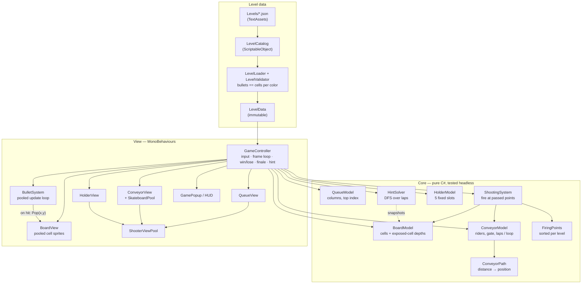
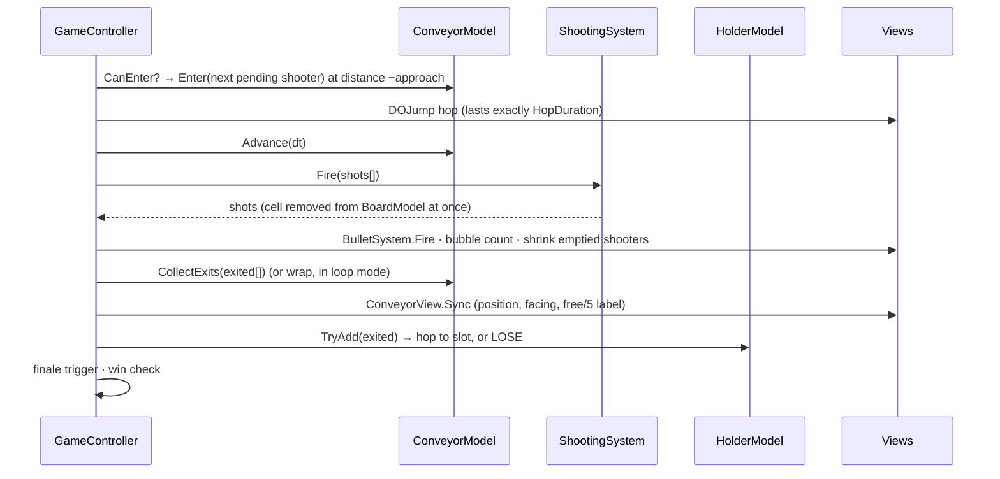

# Pixel Shooting

A Unity 2022.3 puzzle game built as a home assignment. The player sends shooters around a conveyor; each shooter fires at the **exposed** cells of its own color on a pixel-art board. Clear the board to win. Shooters that finish a lap with bullets left wait in a 5-slot holder, and if a 6th one arrives, the level is lost.

- **Engine:** Unity 2022.3.62f2, Built-in render pipeline, Android, portrait only.
- **Scene:** `Assets/_Project/Scenes/Game.unity`. Press Play.
- **Extras beyond the spec:**
  - a loop finale (Part 3 bonus)
  - a **hint button** backed by a solver
  - bullet-count bubbles
  - an "order matters" level (`Level04`)
  - a headless test harness (117 checks)

---

## How to play

| Action | Result |
|---|---|
| Tap the **top shooter** of a queue column | It reserves a conveyor place, hops on and rides one lap, firing at every row and column middle it passes. |
| Tap a shooter in the **holder** | It goes round again, keeping its remaining bullets. |
| Tap **HINT** | The next shooter of a winning order gets a pulsing ring. |
| Conveyor full (`0/5`) | The tapped shooter shakes. |

- **Win:** clear the board. Total bullets always equal total cells, so a win uses up every shooter.
- **Lose:** a 6th shooter arrives at the full holder.
- **Loop finale:** when 5 or fewer shooters are left, input locks, every remaining shooter boards, and the conveyor loops at 3× speed until the board is clear.
- **Editor-only keys:** `1`–`3` load a level, `R` restarts.

---

## Architecture

The code is split into **Core**, pure C# with no `UnityEngine` gameplay dependencies, and **View**, the MonoBehaviours. Core holds all game rules and is unit-tested outside Unity. View reads the models and animates them. Models don't raise events: the controller calls a model, uses its return value, and then tells the views.



### One frame (`GameController.Update`)



### Folder layout

```
Assets/_Project/
  Scripts/Core/      Levels, Board, Queue, Conveyor, Shooting, Holder, Hint, CameraFitMath
  Scripts/View/      GameController, *View, pools, BulletSystem, GamePopup, UiStyle, CameraFitter, SafeAreaPanel
  Levels/            Level01-04.json, Invalid_BulletMismatch.json (validator test), LevelCatalog.asset
  Scenes/Game.unity
Tools/CoreTests/     .NET console harness that compiles the Core sources (outside Assets/, so Unity ignores it)
```

---

## Key systems

### Level data
- **Format:** each level is a JSON grid (palette indices, `-1` = empty, top row first) plus the queue columns, with each shooter's color and bullets.
- **Validation:** `LevelValidator` rejects a level with a clear message unless every color's bullets equal its cell count. That rule guarantees every level can be finished.
- **Isolation:** the rest of the game only sees the immutable `LevelData`.

### Exposed cells: `BoardModel`
- A shooter hits the first non-empty cell of the row or column it faces.
- **Depth per line:** for each side and line, the board stores how far in to start looking. Every cell before that depth is empty.
- **Cost:** queries skip empty cells lazily and save the new depth. Depths only move forward, so the total work per level is at most 4·W·H, which is O(1) amortized per shot.
- **Firing:** it clears the cell **immediately**. That logical removal is the reservation, so two shooters can never target the same cell. The sprite pops later, when the bullet lands.

### Conveyor: no overlap by construction (`ConveyorModel`)
- **Same speed:** every rider moves at the same speed, so gaps never change once they're set.
- **Reserve on tap, wait in place:** a tap only reserves one of the 5 places, and the label updates at once. The shooter **stays where it is** (queue top or holder slot) until the entry gate opens, so nothing ever waits on the track.
- **The hop is part of the ride:** a rider enters at distance `−approach`, where `approach = speed × hopTime`, so the hop lands exactly at distance 0.
- **Gate:** the new rider must be at least `minSpacing` from **every** rider around the loop, both ahead of the entrance and behind it.
- **Why the gate is needed:** two taps 0.1 s apart would otherwise ride overlapped for a whole lap, because the gap equals speed × the time between taps.
- **Lap end:** the lap ends a little before the path's end, just above the entrance. The rider then hops to the holder.

### Shooting: `FiringPoints` + `ShootingSystem`
- **Firing points:** per level, one point per column (bottom and top sides) and per row (right and left sides), placed at the cell centres.
- **Sorted for free:** they're built in lap order, so the list is already sorted.
- **Next point index:** each rider keeps the index of its next point. Each frame it fires at every point it has passed, so it can't skip a line on a slow frame, and nothing is allocated.
- **Frame order:** `Advance → Fire → CollectExits`, so points just before the lap end still fire.

### Holder
- **Slots:** 5 fixed slots, with no sliding.
- **Assigned on exit:** a returning shooter gets the leftmost free slot **the moment it exits the lap**; the hop is only the animation. Two returning shooters can't book the same slot.
- **Freed on departure:** a slot is freed only when its shooter actually leaves, so nothing can land on a shooter that's waiting.

### Loop finale (Part 3 bonus)
- **Trigger:** the shooters still alive **drop** to 5. Levels that start with 5 or fewer never trigger it.
- **Boarding:** input locks, the conveyor switches to loop mode at `speed × loopSpeedMultiplier` (default 3), and every remaining shooter boards one by one through the same gate.
- **Loop mode:** riders wrap at the path end and their firing points start over. Wrapping keeps the gaps around the loop, so it can't cause an overlap.
- **Always wins:** bullets equal cells per color, so every exposed cell matches some looping shooter. The test harness checks this over hundreds of random games.

### Hint: `HintSolver`
- **Model:** it searches for a winning order using *sequential laps*, where one shooter goes round alone, firing by the same rules as `ShootingSystem`.
- **Starting state:** riders already on the conveyor finish their lap first, then taps that are already pending, then the search begins.
- **Search:** depth-first, trying the move with the most immediate hits first, within a node budget. If the budget runs out, it falls back to the greedy best move.
- **Snapshots:** it works on board copies (`BoardModel.CopyFrom`) and never touches the live game.
- **Measured cost:** about 0.3 ms on the biggest level, and 0 bytes allocated on repeat calls.
- **Display:** the suggested shooter gets a pulsing ring for a few seconds; any tap clears it.

### Presentation
- **DOTween:** handles one-off moves such as hops, the queue shifting up, shakes, pops and the popup.
- **No tweens for:** riding the conveyor and bullet flight. Those are driven by the model and a pooled update loop, because the model is the source of truth for firing.
- **Camera fit:** `CameraFitter` fits a fixed world rectangle inside `Screen.safeArea` on any aspect ratio. `SafeAreaPanel` does the same for the HUD.
- **Code-built HUD widgets:** `GamePopup` and the hint button are styled in code (`UiStyle`, `RoundedSprite`, a runtime 9-sliced texture), because the package ships no UI panel sprite.

---

## Performance

| Concern | What the code does |
|---|---|
| Per-frame allocations | None in gameplay: fixed arrays (`riders[5]`, `shots[32]`, `exited[5]`, pending FIFO), and caller-owned output buffers. |
| Pooling | Shooter views, skateboards, bullets and board cells are all pooled and prewarmed. Restarting a level reuses the arrays. |
| Strings | Labels use TMP's allocation-free `SetText("{0}/5", n)`, and only when the value changes. |
| Closures | DOTween callbacks are cached delegates (`ReleaseCallback`). No capturing lambdas. |
| Boxing | No enums or structs through `object`; dictionaries are keyed by class (`Shooter`). |
| Unity APIs | No `GetComponent`/`Find` at runtime; `sharedMaterials` is read once (it allocates on every call). Shooter tint uses a `MaterialPropertyBlock`, so there are no material copies. |
| DOTween | `DOTween.Init(...).SetCapacity(200, 50)` at startup, with recycling on. |

Allocation-free behaviour is **asserted in the tests**, using `GC.GetAllocatedBytesForCurrentThread` around the hot paths.

---

## Tests

`Tools/CoreTests` is a .NET console app. It compiles the Core sources directly against a tiny `UnityEngine` shim (`Vector2`, `Color32`, `JsonUtility`…).

```
cd Tools/CoreTests
dotnet run
```

| Suite | Checks | Highlights |
|---|---|---|
| Level loading/validation | 14 | Malformed JSON, bad colors, bullet/cell mismatch rejected |
| Board model | 17 | 42k random exposed-cell queries vs. brute force; 0 allocations |
| Queue model | 7 | Only the top can be taken; columns are independent |
| Conveyor | 33 | Two-sided gate, lap end, 20k-step random sim (gaps never below `minSpacing`), 0 allocations |
| Shooting | 13 | Lap order, blocking colors, lap-end cut-off, full Level03 sim (bullets left == cells left, every frame) |
| Holder | 11 | Leftmost free slot, no sliding, 6th arrival = lose |
| Level04 | 3 | Winnable (DFS finds an order), and random tapping loses ≥ 1/3 of games |
| Loop finale | 10 | Wrapping, speed jump, whole random games: **every finale wins** |
| Hint solver | 9 | Following the hints wins Levels 1–4; works mid-game; 0 allocations on repeat |

**117 checks, all passing.** View code is verified by play-testing in the Unity Editor (Device Simulator: notch phone, 16:9 phone, iPad).

---

## Levels

| Level | Size | Notes |
|---|---|---|
| Level01 | 4×4 | Two colors, tutorial-sized (too few shooters to trigger the finale) |
| Level02 | 6×6 | Holes in the corners |
| Level03 | 10×10 | Concentric rings, 3 queue columns |
| Level04 | 6×6 | **Order matters:** the outer ring's only shooter is buried in column 0. Random tapping loses about 46% of games. |

Adding a level: drop a JSON file into `Assets/_Project/Levels/` and add it to `LevelCatalog`. Invalid levels are logged and skipped at runtime.

---

## Known limitations

- **Left side on large grids:** the lap ends slightly up the left side, so on large grids the bottom row can't be shot *from the left*. It's still reachable from below.
- **Rotation snap:** a shooter that runs out of bullets snaps to its default rotation while it shrinks. That's cosmetic.
- **Wide screens:** on tablets wider than the background art, the camera background colour fills the sides.

---

## How AI was used

The project was built with Claude Code as a pair programmer: spec breakdown, design options with trade-offs, implementation, reviews of the code I wrote, and the headless test harness. `AI_USAGE.md` logs every part: who wrote what, which decisions were mine, and what was changed or rejected.
